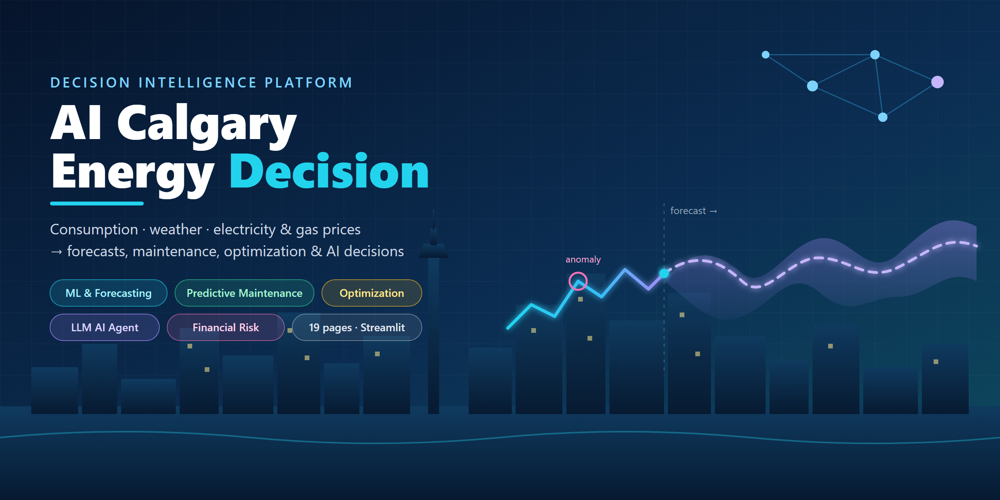
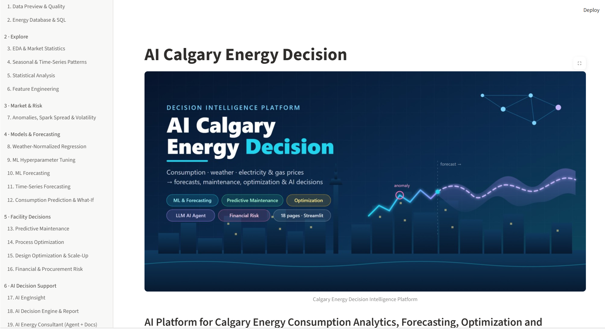
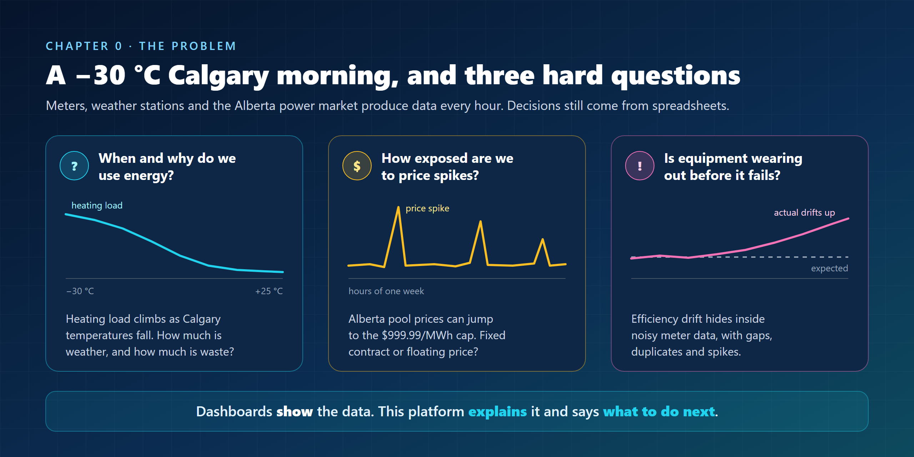
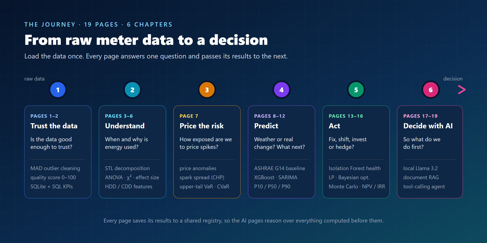
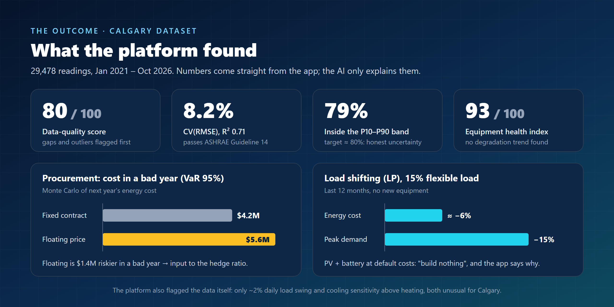
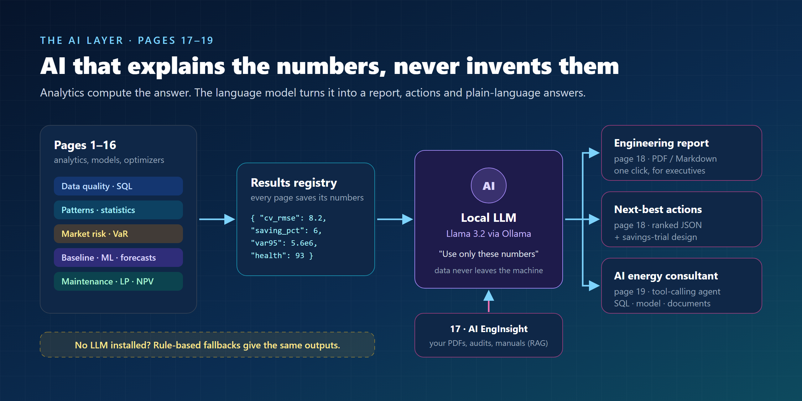
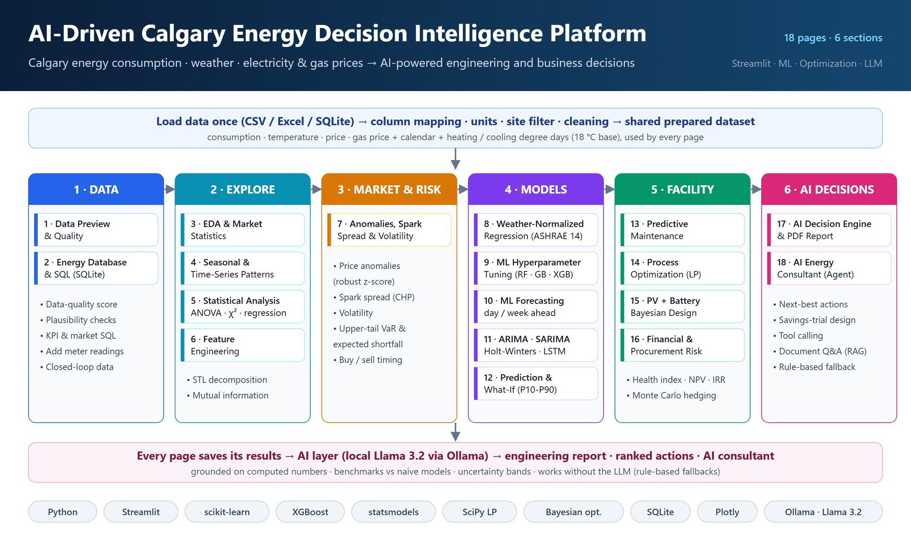

<h1 align="center">AI Calgary Energy Decision</h1>

<p align="center">
    <b>Decision Intelligence Platform for Calgary energy consumption</b>
</p>


<p align="center">
    <a href="https://youtu.be/25EDNaeKpug" target="_blank">
        
    </a>
</p>

<p align="center">
    <b>
        Multi-source Data → AI Analytics → Optimization → Engineering Recommendation
    </b>
</p>

<hr>

## Demo videos

| Demo | Covers | Video |
|---|---|---|
| Full platform demo | End-to-end overview | [Watch](https://youtu.be/25EDNaeKpug) |
| Data management & optimization | Pages 1-2 | [Watch](https://youtu.be/1lSPcDRn0qI) |
| Data exploration & analysis | Pages 3-6 | [Watch](https://youtu.be/bJto9DCn_GY) |
| Monitoring & risk management | Page 7 | [Watch](https://youtu.be/vnX08MvD7KQ) |
| Modeling & forecasting | Pages 8-12 | [Watch](https://youtu.be/8IeEvuXxOpg) |
| Predictive maintenance & process optimization | Pages 13-14 | [Watch](https://youtu.be/GTwec-38Nk8) |
| Design optimization & financial risk | Pages 15-16 | [Watch](https://youtu.be/NKVW4XFD6yE) |
| AI EngInsight | Page 17 | [Watch](https://youtu.be/3h5QkFAIRgg) |
| AI-powered decision support | Pages 18-19 | [Watch](https://youtu.be/crcqm_I5jcA) |

<hr>

## Project overview & energy challenge

<h3 align="center">AI-Driven Calgary Energy Consumption Analytics</h3>

<p align="center">
    
</p>

Modern energy systems generate large volumes of data from electricity markets, smart meters, weather systems,
renewable generation, and industrial operations. However, fragmented data sources make it difficult to transform
raw information into timely business decisions.

This project is an end-to-end AI / machine-learning platform for **Calgary energy consumption**. It takes raw
consumption, weather, electricity-price and gas-price data and walks it through data quality, exploration, market
risk, forecasting, predictive maintenance, optimization, financial analysis, and finally an AI decision engine and
AI consultant that turn the results into recommended actions.

**From energy consumption data to engineering and business decisions, in one Streamlit app.**

Energy data tells you what happened. It rarely tells you what to do. This platform turns meter, weather and price
data into decisions: 19 pages, 6 categories, local AI.

- **Data management** cleans the data, scores its quality and stores it in a SQLite database.
- **Exploration** finds when and why energy is used, with seasonal patterns, STL, ANOVA and feature engineering.
- **Risk monitoring** flags price anomalies and measures spark spread and Value-at-Risk.
- **Forecasting** builds ASHRAE G14 baselines with over/underfitting checks, hyperparameter-tuned XGBoost,
  day-ahead and SARIMA forecasts, and P10–P90 what-if scenarios.
- **Facility decisions** cover predictive maintenance (Isolation Forest, health index), load shifting by linear
  programming, PV + battery sizing with Bayesian optimization, and Monte Carlo procurement with NPV/IRR.
- **AI decision support** includes the EngInsight PDF briefing (findings, recommendations, figures, numbers
  checked), a Decision Engine PDF report with ranked actions, and an AI Consultant for Q&A over data and documents.

<p align="center">
    
</p>

### Results at a glance (Calgary data)

- Data quality **80 / 100**, problems flagged
- Baseline CV(RMSE) **8.2%**: passes ASHRAE G14
- Health index **93 / 100**
- Load shifting: **≈ 6% lower cost**, **15% lower peak**
- Solar + battery: **"build nothing"** at today's costs
- 64-page report briefed in **~9 min**

<hr>

## Table of contents

1. [The story: from a cold Calgary morning to a decision](#1-the-story-from-a-cold-calgary-morning-to-a-decision)
2. [What the platform does](#2-what-the-platform-does)
3. [The 19 pages](#3-the-19-pages)
4. [AI / ML skills demonstrated](#4-ai--ml-skills-demonstrated)
5. [Benefits: who it helps and how](#5-benefits-who-it-helps-and-how)
6. [Architecture](#6-architecture)
7. [Results on the Calgary dataset](#7-results-on-the-calgary-dataset)
8. [Quick start](#8-quick-start)
9. [Data format](#9-data-format)
10. [Project structure](#10-project-structure)
11. [Technology stack](#11-technology-stack)
12. [Design choices that make results trustworthy](#12-design-choices-that-make-results-trustworthy)
13. [Limitations](#13-limitations)
14. [Roadmap](#14-roadmap)

---

## 1. The story: from a cold Calgary morning to a decision

### Chapter 0 · The problem

It is −30 °C in Calgary. The heating plant is running flat out, the Alberta pool price is jumping, and
somewhere in the plant a fan motor is slowly losing efficiency. The data to see all of this already exists:
meters, weather stations and the power market record it every hour. But the decisions are still made from
spreadsheets and dashboards that **show** data without **explaining** it or saying **what to do next**.

<p align="center">
    
</p>

The energy manager has three questions. How much of our use is weather and how much is waste? How exposed
are we to price spikes? Is equipment wearing out before it fails? This platform answers them in six chapters.

### Chapters 1 to 6 · The journey

<p align="center">
    
</p>

**Chapter 1 · Trust the data (pages 1–2).** Before any model, the platform checks the data. On the Calgary
dataset it gave a quality score of **80 / 100** and found irregular time steps, 40 duplicate timestamps and
temperatures up to 43.6 °C, which is not realistic for Calgary. Bad data produces confident, wrong models, so
this comes first.

**Chapter 2 · Understand (pages 3–6).** Seasonal profiles, a weekday × hour heatmap and STL decomposition show
*when* energy is used. Heating and cooling degree days turn the weather into a physical driver. ANOVA and
effect sizes separate what is significant from what actually matters.

**Chapter 3 · Price the risk (page 7).** For a buyer, the risk is high prices. The platform measures price
anomalies, the spark spread for on-site gas generation, and upper-tail VaR: the average price was
**104.5 $/MWh**, but the worst 5% of hours were above **132 $/MWh**.

**Chapter 4 · Predict (pages 8–12).** Did consumption really change, or was it a cold year? A weather-normalized
baseline answers that, with **R² 0.71** and **CV(RMSE) 8.2%**, which passes ASHRAE Guideline 14. Tuned ML
and time-series models are always compared with a naive forecast, and the P10–P90 band held **79%** of real
readings, close to the 80% target.

**Chapter 5 · Act (pages 13–16).** Now the platform turns insight into action:
- **Predictive maintenance:** health index **93 / 100**, so no degradation trend yet.
- **Load shifting (linear programming):** **≈ 6% lower cost** and **15% lower peak** with no new equipment.
- **Solar PV + battery (Bayesian optimization):** at default costs the honest answer is **build nothing**,
  and the page shows what would change that.
- **Procurement (Monte Carlo):** in a bad year, a floating price would cost **$5.6M** against **$4.2M**
  for a fixed contract.

<p align="center">
    
</p>

**Chapter 6 · Decide with AI (pages 17–19).** Every page saves its results. A local language model
(Llama 3.2 via Ollama) reads those numbers and writes the engineering report, ranks the next-best actions and
answers questions as a tool-calling consultant. It never invents numbers, the data never leaves the machine,
and without the LLM every feature falls back to transparent rules.

<p align="center">
    
</p>

**The ending.** The energy manager starts the meeting with one PDF: the data is usable but flagged, the
baseline is defensible, load shifting saves about 6% now, solar does not pay yet, and a fixed contract
lowers bad-year risk by $1.4M. Dashboards *show* the data. This platform *explains* it and says *what to do
next*.

### The questions it answers

| Question | Where it is answered |
|---|---|
| Is my data good enough to trust? | 1. Data Preview & Quality |
| When and why is energy used? | 3-6. EDA, seasonal patterns, statistics, features |
| How exposed am I to price spikes? | 7. Anomalies, Spark Spread & Volatility |
| Did consumption really change, or was it just the weather? | 8. Weather-Normalized Regression |
| How much will I use tomorrow / next month? | 9-12. ML, time-series forecasting, prediction |
| Is equipment degrading before it fails? | 13. Predictive Maintenance |
| How can I cut cost without new equipment? | 14. Process Optimization (load shifting) |
| Should I invest in solar PV and batteries? | 15. Design Optimization & Scale-Up |
| Should I buy power at a fixed or floating price? | 16. Financial & Procurement Risk |
| What do our reports and manuals say? | 17. AI EngInsight |
| So what should we do first? | 18. AI Decision Engine, 19. AI Energy Consultant |

---

## 2. What the platform does

**Load data once → check quality → explore patterns → measure market risk → model and forecast consumption →
detect equipment problems → optimize operations and investments → AI report + recommended actions**

- **One data setup for every page.** Upload a CSV/Excel file once in the sidebar, map the columns
  (date, consumption, temperature, price, gas price), choose the unit and optional cleaning. Every page uses
  the same prepared dataset.
- **Every page saves its results** to a shared registry, so the AI pages can reason over everything that
  was analysed in the session.
- **AI is optional, analytics are not.** All analytics, models and optimizers run without an LLM. A local
  LLM (Llama 3.2 via Ollama) adds plain-language interpretation, reports and a chat consultant. Without it,
  the decision pages fall back to transparent rule-based logic.

---

## 3. The 19 pages

The sidebar groups the pages into six sections, in the order you would use them.

### Section 1 · Data

| # | Page | What it does |
|---|---|---|
| 1 | **Data Preview & Quality** | Column profile, time coverage and gaps, plausibility checks (Calgary temperature range, daily load cycle, heating response), **data-quality score (0-100)**, AI data-quality review |
| 2 | **Energy Database & SQL** | Writes the cleaned data to a **SQLite** database; ready-made SQL for KPIs, peak days, temperature bands, peak/cheap price hours, weekend discount, peak index, monthly cost; validated form to **add new meter readings**; reloads the database as the data source (closed loop) |

<p align="center">
    <a href="https://youtu.be/1lSPcDRn0qI" target="_blank">
        
    </a>
</p>

### Section 2 · Explore

| # | Page | What it does |
|---|---|---|
| 3 | **EDA & Market Statistics** | Consumption, price and gas statistics (mean, CV, skewness, P95/P99), distributions, consumption vs temperature and vs price, category comparisons, correlation heatmap, leakage warnings |
| 4 | **Seasonal & Time-Series Patterns** | Seasonal KPIs, daily profile by season, weekday × hour heatmap, year-over-year trend, **STL decomposition** with seasonal / trend strength |
| 5 | **Statistical Analysis** | Pearson & Spearman correlation, simple and multiple regression with VIF, **ANOVA** with η² and Kruskal-Wallis, **chi-square** with Cramér's V |
| 6 | **Feature Engineering** | Calendar, weather (HDD/CDD), **time-based** lags and rolling statistics, spike and ramp features, **mutual information** ranking, CSV export |

<p align="center">
    <a href="https://youtu.be/bJto9DCn_GY" target="_blank">
        
    </a>
</p>


### Section 3 · Market & Risk

| # | Page | What it does |
|---|---|---|
| 7 | **Anomalies, Spark Spread & Volatility** | Price anomalies (robust z-score vs same season and hour), **spark spread** (gas-fired / CHP economics), volatility, **upper-tail VaR and expected shortfall**, best buy / sell hours |

<p align="center">
    <a href="https://youtu.be/vnX08MvD7KQ" target="_blank">
        
    </a>
</p>


### Section 4 · Models & Forecasting

| # | Page | What it does |
|---|---|---|
| 8 | **Weather-Normalized Regression** | HDD/CDD baseline (Linear, Ridge, Lasso, Polynomial), **ASHRAE Guideline 14** check (CV(RMSE), NMBE), OLS significance, avoided energy and CUSUM (IPMVP Option C style) |
| 9 | **ML Hyperparameter Tuning** | Random Forest, Gradient Boosting, XGBoost, Ridge with Grid / Randomized search and **time-series cross-validation**, overfitting ratio, hold-out test vs **naive benchmark**, permutation importance, model download |
| 10 | **ML Forecasting** | Leakage-free **day-ahead / week-ahead** forecast (only information available at forecast time), back-test vs naive, 80% interval, CSV export |
| 11 | **Time-Series Forecasting** | ADF test, ACF / PACF, **ARIMA, SARIMA, Holt-Winters**, optional **LSTM**, scored against a seasonal-naive benchmark, forward forecast with interval |
| 12 | **Consumption Prediction & What-If** | **Quantile gradient boosting (P10 / P50 / P90)**, interval coverage check, what-if scenarios, temperature-response curve, check a measured reading and save it to the database |

<p align="center">
    <a href="https://youtu.be/8IeEvuXxOpg" target="_blank">
        
    </a>
</p>


### Section 5 · Facility Decisions

| # | Page | What it does |
|---|---|---|
| 13 | **Predictive Maintenance** | Expected-consumption model on a healthy period, efficiency drift, **Isolation Forest** anomalies, overload and ramp stress, **daily health index**, days until the high-risk threshold, next-day risk classifier vs persistence benchmark, prioritised maintenance actions |
| 14 | **Process Optimization** | **Linear-programming load shifting** (energy + demand charge), efficiency measures with payback and NPV, colder/warmer-year scenarios |
| 15 | **Design Optimization & Scale-Up** | Hourly **battery + PV dispatch LP** on representative days, NPV landscape, **Bayesian optimization** of PV and battery size, price / yield uncertainty, **portfolio scale-up** and avoided CO₂e |
| 16 | **Financial & Procurement Risk** | Load-weighted vs market price, 12-month budget (P10-P90), **Monte Carlo fixed vs floating procurement**, cost VaR / CVaR, optimal **hedge ratio**, investment appraisal (**NPV, IRR**, simple and discounted payback, sensitivity) |

<p align="center">
    <a href="https://youtu.be/GTwec-38Nk8" target="_blank">
        
    </a>
</p>


<p align="center">
    <a href="https://youtu.be/NKVW4XFD6yE" target="_blank">
        
    </a>
</p>


### Section 6 · AI Decision Support

| # | Page | What it does |
|---|---|---|
| 17 | **AI EngInsight** | Engineering **document assistant**: upload reports, audits, manuals or papers (PDF / DOCX / TXT) → structured **summary**, **deep technical analysis**, and **chat with documents** (RAG: chunking, TF-IDF retrieval, cited sources) |
| 18 | **AI Decision Engine & Report** | Combines all saved page results into a structured payload → **LLM engineering report (PDF / Markdown)**, ranked **next-best actions** (JSON), and **savings-trial design** (how many days a trial must run to prove a saving statistically) |
| 19 | **AI Energy Consultant** | **Tool-calling agent**: SQL database, prediction model, saved page results, market summary, document search and trial sizing; quick questions; **document Q&A (RAG)** over your PDFs / DOCX / TXT; tool console that works without the LLM |

<p align="center">
    <a href="https://youtu.be/3h5QkFAIRgg" target="_blank">
        
    </a>
</p>

<p align="center">
    <a href="https://youtu.be/crcqm_I5jcA" target="_blank">
        
    </a>
</p>

---

## 4. AI / ML skills demonstrated

### 4.1 Data engineering

| Skill | Implementation |
|---|---|
| ETL pipeline | Upload (CSV / Excel) → column mapping → typing → de-duplication → cleaning → feature table |
| Data quality engineering | Coverage, time-step regularity, duplicates, plausibility rules, weighted quality score |
| Time-series preparation | Timestamps from Year/Month/Day/Hour, irregular-step handling, daily aggregation that corrects for missing hours |
| Outlier handling | Robust z-score (MAD) against a 7-day rolling median, remove or cap, Calgary temperature range check |
| Database engineering | SQLite schema, unique index, read-only query connection, validated inserts, database-to-app reload |
| Units & standardization | kWh / MWh / MW handling, consistent cost and kW conversions across pages |

### 4.2 Statistics & exploratory analysis

| Skill | Implementation |
|---|---|
| Descriptive statistics | Mean, median, CV, skewness, kurtosis, upper-tail percentiles |
| Hypothesis testing | Pearson / Spearman, ANOVA + Kruskal-Wallis, chi-square, linear regression p-values |
| Effect sizes | η², Cramér's V, R², VIF for multicollinearity |
| Time-series decomposition | STL (robust), seasonal and trend strength, ADF stationarity, ACF / PACF |
| Energy engineering statistics | Heating / cooling degree days, weather normalization, ASHRAE Guideline 14 (CV(RMSE), NMBE) |

### 4.3 Machine learning

| Skill | Implementation |
|---|---|
| Regression models | Linear, Ridge, Lasso, Polynomial, Random Forest, Gradient Boosting, HistGradientBoosting, XGBoost |
| Hyperparameter optimization | GridSearchCV, RandomizedSearchCV, overfitting diagnostics, best-parameter effect plots |
| Time-series validation | `TimeSeriesSplit`, chronological hold-out, skill vs naive benchmark |
| Feature engineering | Calendar, weather, time-based lags, rolling stats, ramps, spike flags, mutual information |
| Explainability | Permutation importance, OLS coefficients and confidence intervals, temperature-response curves |
| Uncertainty quantification | Quantile regression (P10 / P50 / P90), interval coverage, residual-based forecast intervals |
| Anomaly detection | Isolation Forest, robust z-score (MAD), seasonal-hour baselines |
| Classification | Random Forest classifier for next-day maintenance risk, ROC AUC, confusion matrix, persistence benchmark |
| Leakage prevention | Lags only from information available at prediction time; warnings for target-copy columns |
| Model persistence | Tuned model export with joblib |

### 4.4 Forecasting & deep learning

| Skill | Implementation |
|---|---|
| ML forecasting | Direct day-ahead / week-ahead models with climatology temperature for the future |
| Classical time series | ARIMA, SARIMA (weekly season), damped Holt-Winters |
| Deep learning | Optional LSTM (TensorFlow / Keras) with recursive multi-step forecasting |
| Forecast evaluation | MAE, RMSE, MAPE, CV(RMSE), skill vs seasonal-naive, back-testing |

### 4.5 Optimization & operations research

| Skill | Implementation |
|---|---|
| Linear programming | Load shifting with energy conservation and peak variable; battery + PV dispatch with state of charge, efficiency, export limits (SciPy HiGHS) |
| Bayesian optimization | PV and battery sizing to maximize NPV, warm-started from a grid search |
| Monte Carlo simulation | Next-year cost distribution, price-level uncertainty, hedge-ratio risk-cost frontier |
| Risk metrics | Upper-tail VaR, expected shortfall / CVaR, sensitivity (tornado) analysis |
| Financial engineering | NPV, IRR (root finding), simple and discounted payback, escalation, portfolio scale-up |
| Experimental design | Sample-size calculation for savings trials, including autocorrelation correction |

### 4.6 AI, LLM & agents

| Skill | Implementation |
|---|---|
| LLM integration | Local Llama 3.2 through Ollama; no data leaves the machine |
| Prompt engineering | Structured JSON payloads, section-by-section report prompts, "use only these numbers" grounding |
| Structured output | JSON-mode decision engine with schema validation and safe fallback |
| Tool-calling agent | Native Ollama tool calling over 6 Python tools with a multi-step loop and visible tool trace |
| Retrieval-augmented generation | Document chunking, TF-IDF vectors, cosine-similarity retrieval for PDF / DOCX / TXT |
| Responsible AI | Rule-based fallbacks, transparent inputs, warnings when models do not beat simple benchmarks |
| Reporting | Automatic PDF (ReportLab) and Markdown engineering reports |

### 4.7 Software engineering & deployment

| Skill | Implementation |
|---|---|
| Application architecture | Router (`st.navigation`) + shared engine module + 19 independent pages |
| State management | Session-state data setup, results registry shared across pages |
| Performance | `st.cache_data` / `st.cache_resource` for prepared data and trained models |
| Robustness | Graceful handling of missing columns, irregular data, missing optional libraries, Windows process-pool fallback |
| Testing | Every page exercised headlessly with Streamlit `AppTest` on the real dataset |

---

## 5. Benefits: who it helps and how

### Energy and facility managers
- See **where and when** energy is used and what drives it (weather, schedule, season).
- Get an **early warning** when equipment efficiency drifts, with days-to-risk and concrete maintenance actions.
- Quantify **load-shifting savings** and **peak (demand-charge) reduction** without new equipment.

### Finance and procurement teams
- A **12-month energy budget** with a realistic range instead of a single number.
- **Fixed vs floating** price decision with cost Value-at-Risk and a recommended hedge ratio.
- **NPV, IRR and payback** for efficiency, solar PV and battery projects, with sensitivity analysis.

### Energy engineers and M&V specialists
- **Weather-normalized baselines** checked against ASHRAE Guideline 14.
- Avoided-energy and CUSUM tracking (IPMVP Option C style).
- **Trial design**: how long a savings trial must run to be statistically convincing.

### Executives
- A one-click **engineering report (PDF)** and a ranked list of **next-best actions**.
- An **AI consultant** that answers questions with numbers from the data, not generic advice.

### Data and AI teams
- A reusable template for **leakage-free time-series ML**, honest benchmarking, uncertainty and optimization.
- A practical example of **grounded LLM use**: tools and structured data first, language second.

### Sustainability
- Avoided **tCO₂e** from PV and efficiency scenarios (emission factor as an input), supporting
  decarbonization planning.

---

## 6. Architecture

```
Calgary data (consumption, weather, price, gas)
        │  upload CSV / Excel, or SQLite database
        ▼
Sidebar data setup (Home.py → calgary_utils.sidebar_data_setup)
  column mapping · units · site filter · duplicates · outliers · temperature checks
        │
        ▼
Shared prepared dataset (calgary_utils.prepare)
  consumption, temperature, price, gas_price + calendar + HDD/CDD
        │
        ├── 1-2   Data quality · SQLite database & SQL
        ├── 3-6   EDA · seasonal patterns · statistics · feature engineering
        ├── 7     Market risk: anomalies · spark spread · VaR
        ├── 8-12  Weather regression · tuned ML · ML & time-series forecasts · P10/P50/P90
        ├── 13-16 Predictive maintenance · load-shifting LP · PV+battery Bayesian design · finance
        │
        ▼
Results registry (every page saves its key results)
        │
        ├── 17  AI EngInsight: document summary · deep analysis · chat with documents
        ├── 18  AI Decision Engine: report (PDF) · next-best actions · trial design
        └── 19  AI Energy Consultant: tool-calling agent · document RAG
                     │
                     ▼
            Local LLM (Ollama · Llama 3.2), optional, with rule-based fallbacks
```

<p align="center">
    
</p>

---

## 7. Results on the Calgary dataset

Results on the Calgary dataset used during development (`preprocessor.xlsx`, not included in the repository:
29,478 readings, Jan 2021 to Oct 2026, consumption column `Electricity_kWh`, no outlier cleaning). They show what
each page produces; they are **only as reliable as the data** (see the data-quality findings below).

| Area | Result |
|---|---|
| Data quality | Score **80 / 100**; 58% time coverage, 69% regular time steps, 40 duplicate timestamps |
| Market | Average electricity price **104.5 $/MWh**; upper-tail VaR95 **132 $/MWh**; load-weighted price **+2.3%** above market average |
| Weather-normalized regression | Daily R² **0.71**, CV(RMSE) **8.2%**, NMBE **0.0%** → passes ASHRAE Guideline 14 |
| ML tuning (Random Forest) | Hold-out R² **0.32**, CV(RMSE) 16%: hour-to-hour consumption in this dataset is mostly noise |
| Prediction (P10 / P50 / P90) | **79%** of real readings inside the P10-P90 band (target ≈ 80%) |
| Predictive maintenance | Health index **93 / 100**, no significant degradation trend |
| Load shifting (15% flexible load) | **≈ 6% cost saving** and **15% peak reduction** over the last 12 months |
| PV + battery design | At default costs and prices the NPV-optimal design is **build nothing**: neither pays back over 20 years |
| Procurement | Floating-price bad-year cost (VaR95) **$5.6M** vs fixed contract **$4.2M** |

**Data-quality findings the platform flagged automatically:**
- The average daily load profile varies only **~2%** between hours; real buildings and grids usually swing
  20-60%.
- Cooling sensitivity is larger than heating sensitivity, which is unusual for Calgary's heating-dominated
  climate.
- Temperatures reach 43.6 °C (outside Calgary's realistic range) and step by season.

These checks are a feature: the platform tells you when the data, not the model, is the limiting factor.

---

## 8. Quick start

### Requirements
- Python 3.10 or newer
- Optional: [Ollama](https://ollama.com) for the AI features

### Install and run

```bash
git clone <your-repo-url>
cd <repo-folder>
pip install -r requirements.txt
streamlit run Home.py
```

### Enable the local LLM (optional)

```bash
ollama pull llama3.2
```

Keep the Ollama app running; the pages detect it automatically.

### Use it
1. Upload your data in the sidebar (or click **Use synthetic demo data**).
2. Open **Columns, units & cleaning** and check the mapping.
3. Follow the recommended path: **1 → 2 → 3 → 4 → 8 → 9 → 12 → 13 → 14 → 15 → 16 → 18 → 19**
   (use 17 whenever you have documents).

---

## 9. Data format

One table (CSV or Excel), one row per reading. Column names are free; you map them in the sidebar.

| Field | Required | Example column | Notes |
|---|---|---|---|
| Timestamp | yes | `Date` or `Year`,`Month`,`Day`,`Hour` | hourly, sub-daily or daily |
| Consumption | yes | `Electricity_kWh` | kWh, MWh or MW (set the unit) |
| Outdoor temperature | recommended | `Temperature_C` | °C, needed for weather normalization |
| Electricity price | recommended | `Electricity_Price_CAD_MWh` | $/MWh, needed for cost, market and finance pages |
| Gas price | optional | `Gas_Price_CAD_GJ` | $/GJ, needed for spark spread |
| Site / city | optional | `City` | enables the site filter |
| Maintenance label | optional | any 0/1 column | real failure / work-order events for page 13 |

No data? Click **Use synthetic demo data** for a 3-year hourly Calgary-style facility (clearly labelled as
synthetic).

---

## 10. Project structure

```
Deploy & Streamlit/
├── Home.py                  # entry point: page config, sidebar data setup, navigation
├── calgary_utils.py         # shared engine: data prep, features, metrics, models, SQLite, PDF, LLM
├── sections/                # the platform pages
│   ├── 00_Home.py
│   ├── 01_Data_Preview_Quality.py
│   ├── 02_Energy_Database_SQL.py
│   ├── 03_EDA_Market_Statistics.py
│   ├── 04_Seasonal_Time_Series.py
│   ├── 05_Statistical_Analysis.py
│   ├── 06_Feature_Engineering.py
│   ├── 07_Anomaly_Spark_Volatility.py
│   ├── 08_Weather_Normalized_Regression.py
│   ├── 09_ML_Hyperparameter_Tuning.py
│   ├── 10_ML_Forecasting.py
│   ├── 11_Time_Series_Forecasting.py
│   ├── 12_Consumption_Prediction_WhatIf.py
│   ├── 13_Predictive_Maintenance.py
│   ├── 14_Process_Optimization.py
│   ├── 15_Design_Optimization_ScaleUp.py
│   ├── 16_Financial_Risk_Analysis.py
│   ├── 17_AI_EngInsight.py
│   ├── 18_AI_Decision_Engine.py
│   └── 19_AI_Energy_Consultant.py
├── images/                  # README pictures (banner + story)
├── assets/                  # demo thumbnail used in this README
├── pic1.jpg, pic2.png       # images used on the Home page
├── requirements.txt
└── README.md
```

`calgary_energy.db` is created on page 2 the first time you write the dataset to the database.

---

## 11. Technology stack

| Layer | Tools |
|---|---|
| Language | Python |
| App | Streamlit (multi-page navigation, session state, caching) |
| Data | pandas, NumPy, openpyxl |
| Statistics | SciPy, statsmodels |
| Machine learning | scikit-learn, XGBoost |
| Deep learning (optional) | TensorFlow / Keras (LSTM) |
| Optimization | SciPy `linprog` (HiGHS), bayesian-optimization |
| Database | SQLite |
| Visualization | Plotly |
| LLM / agents | Ollama (Llama 3.2), native tool calling |
| Retrieval | scikit-learn TF-IDF, pypdf, python-docx |
| Reporting | ReportLab (PDF), Markdown |

---

## 12. Design choices that make results trustworthy

- **Benchmarks everywhere.** ML and time-series models are always compared with a naive forecast; the app says
  so when a model does not add value.
- **No look-ahead leakage.** Forecast features only use information available at forecast time; cross-validation
  is chronological.
- **Uncertainty, not just point values.** P10/P50/P90 bands, interval coverage, Monte Carlo cost ranges, NPV
  sensitivity.
- **Grounded AI.** The LLM receives computed results as JSON and is told to use only those numbers; every
  AI feature has a rule-based fallback.
- **Data-quality first.** Page 1 and the sidebar flag irregular timestamps, duplicates, outliers and implausible
  values before any model is trusted.


